

# 🛡️ pfSense Firewall — Isolated Network Security Home Lab

### Build → Test → Defend → Validate

**VMware Workstation · pfSense CE 2.8.1 · Kali Linux · Windows · Segmented Networks · Wireshark**

**Sushil Tamang | Cybersecurity Home Lab | Perth, Western Australia**

[Architecture](#-network-architecture) • [Build walkthrough](#-step-by-step-project-implementation) • [Validation](#-observed-test-results) • [Evidence](docs/EVIDENCE.md)

---

## 📌 Project overview

I built an isolated enterprise-style home lab using **pfSense Community Edition** as a virtual firewall within **VMware Workstation**, with separate **Employee** and **Guest** networks and an **external Kali Linux test client**. The project explores routing, network address translation (NAT), DHCP service visibility, firewall rules, management-plane security, and packet-level investigation.

I configured and examined firewall policies intended to **restrict Guest access to the Employee subnet**, tested network reachability from Kali and Windows, and examined TCP SYN traffic in **Wireshark**. The attached evidence demonstrates both successful connectivity and unsuccessful probes, providing a foundation for the SOC analyst's **build → test → defend** workflow.

> **Evidence scope:** This case study is grounded in the original screenshots, not invented lab results. The original images are catalogued at [docs/EVIDENCE.md](docs/EVIDENCE.md). The original eleven evidence images are present in `assets/evidence/`; the seven additional privacy-redacted VPN/Snort images are prepared separately for upload. The architecture drawing is the original *network design*, while the pfSense dashboard provides observed deployed interface addresses.

## 🎯 Project goals

- Deploy a pfSense firewall VM and establish isolated network interfaces using VMware virtual networks.
- Configure and verify **WAN, Employee, and Guest** interface addressing.
- Inspect DHCP and other firewall services, applying a least-privilege approach to management access.
- Create ordered firewall rules that isolate Guest traffic from Employee systems.
- Generate controlled, authorized test traffic from Kali Linux and inspect the traffic observed by pfSense and Wireshark.
- Compare packet evidence, policy counters and actual connectivity rather than treating a failed ping alone as proof of effective filtering.
- Document the findings from a **SOC Level 1 / junior security analyst** perspective.

## 🧰 Technology stack

| Technology | Purpose |
|---|---|
| pfSense CE **2.8.1** | Virtual firewall, routing, interface policies, NAT, DHCP service |
| VMware Workstation | Virtual networking and isolation |
| Kali Linux | External authorized test client on VMware NAT network |
| Windows 10 VM | Employee endpoint, `10.1.1.100/24` in captured evidence |
| Guest Linux VM | Designed Guest-segment endpoint; no separate live screenshot supplied |
| Wireshark | TCP/SYN and retransmission inspection |
| pfBlockerNG | Installed package and DNSBL/IP filtering visibility, not independently verified blocking |
| Browser / CLI | pfSense administration, ping tests and traffic review |

## 🗺️ Network architecture

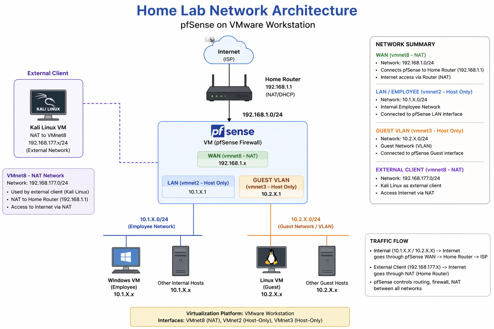

*Figure 1. Original Home Lab Network Architecture for VMware and pfSense. Some labels reflect a planning-stage NAT subnet. The observed pfSense dashboard below is the authoritative evidence for addresses used in the running snapshot.*

### Actual interface addresses in the supplied dashboard

| Network / pfSense interface | VMware role | Observed network and address | Purpose |
|---|---|---|---|
| **WAN** | VMnet8 NAT | `192.168.177.131/24` on pfSense | Upstream/NAT-side lab connectivity |
| **EMPLOYEE** | VMnet2 host-only | `10.1.1.1/24` | Windows Employee LAN |
| **GUEST** | VMnet3 host-only | `10.2.2.1/24` | Isolated Guest LAN |
| **External Kali** | VMnet8 NAT | `192.168.177.x/24` | Kali outside the Employee/Guest interfaces |
| **Windows Employee** | Employee LAN | `10.1.1.100/24`, gateway `10.1.1.1` | Policy and connectivity validation |

**Important distinction:** The architecture drawing labels an upstream `192.168.1.0/24` home-router subnet, while the running pfSense dashboard shows the actual firewall WAN as **`192.168.177.131`** on the VMware NAT network. Likewise, the deployed Guest interface appears as **`10.2.2.1`** rather than a generic `10.2.X.1`. These are recorded as design-vs-deployment differences, not silently overwritten.

### Routing and security boundary

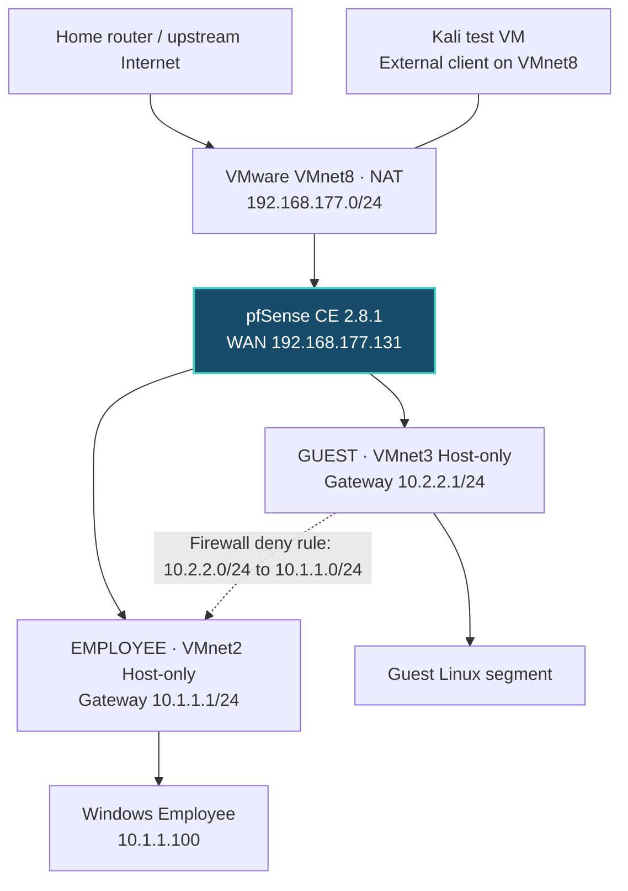

## 🔧 Step-by-step project implementation

### 01 · Build the isolated virtual networks

In VMware Workstation, I designed an external NAT-side interface and two internal host-only networks. Employee and Guest networks terminate on separate pfSense interfaces so inter-network access can be controlled with firewall rules rather than depending on a shared flat network.

The intended virtual network mapping is **VMnet8 = NAT/WAN**, **VMnet2 = Employee**, and **VMnet3 = Guest**. The Employee Windows VM uses a `10.1.1.0/24` address; the Guest network is assigned `10.2.2.0/24` in the running pfSense interface view.

### 02 · Install and configure pfSense CE

I completed the pfSense web configuration wizard and accessed the firewall's management dashboard. The installation screenshot records **“Wizard completed”** and the current dashboard identifies **pfSense CE 2.8.1**.

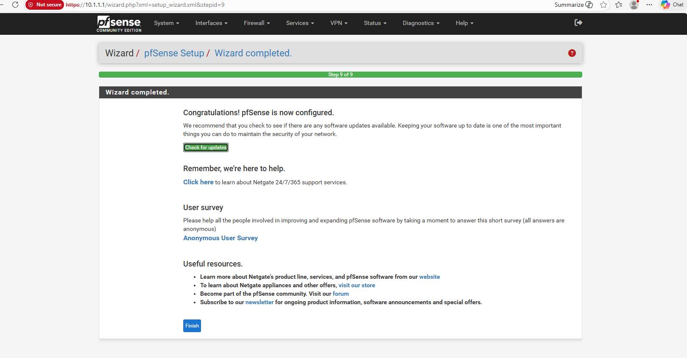

*Figure 2. Original pfSense setup wizard completion.*

### 03 · Verify WAN, Employee and Guest interfaces

I checked the pfSense **Status → Dashboard** interface summary. It shows the three interfaces **up**, WAN **192.168.177.131**, Employee **10.1.1.1**, and Guest **10.2.2.1**. The WAN DHCP gateway shown on that capture is **192.168.177.2** with **Online** status.

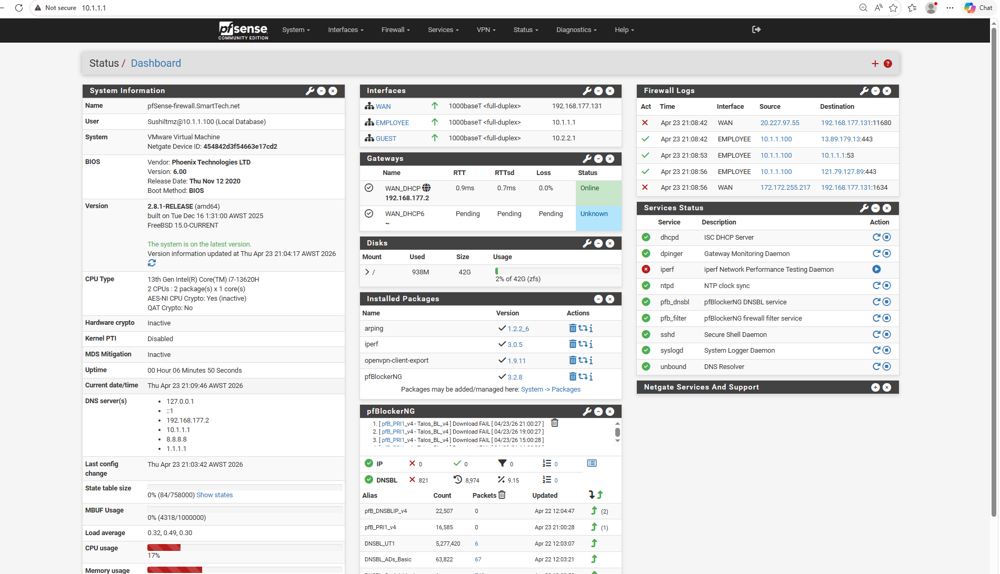

*Figure 3. Live interface, gateway, service and firewall-log status captured in the lab.*

### 04 · Inspect DHCP and management services

The original dashboard shows **dhcpd** (ISC DHCP Server) with a running status alongside **dpinger**, **ntpd**, **sshd**, **syslogd** and **unbound**. DHCP service visibility is confirmed; however, the supplied screenshots do **not** show an individual DHCP lease table or detailed per-interface DHCP pool settings.

For reproducibility, the precise DHCP pool, DNS, gateway distribution and static reservations should be inspected under **Services → DHCP Server / DHCP Leases** in the installed pfSense release.

For the management plane, the screenshots show the GUI reached at **10.1.1.1** from the Employee side. Good operational practice is to restrict GUI/SSH access to authorized management endpoints and use valid HTTPS certificates rather than treating an HTTP/“Not secure” browser label as an acceptable production baseline.

### 05 · Review Employee firewall rules

Under **Firewall → Rules → EMPLOYEE**, the screenshot documents the anti-lockout management rule, pfBlockerNG-related rules, an enabled SSH rule, general Employee pass rules, and an ICMP allow rule. The **Social Media Block** and **Block HTTP from any** entries are visibly **disabled** in the capture and should **not** be reported as enforced.

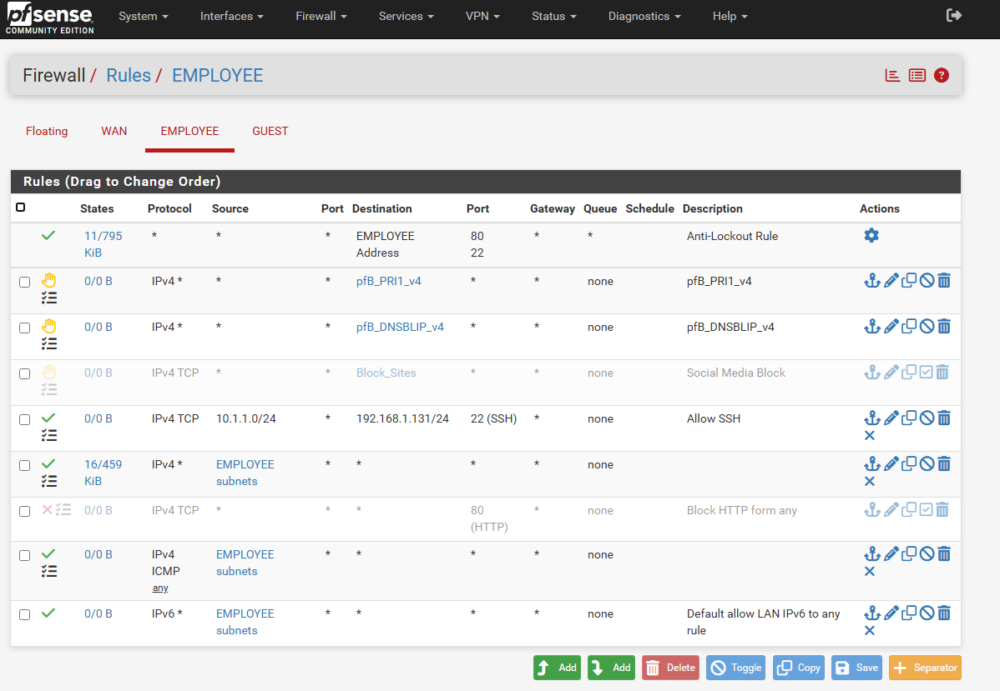

*Figure 4. Actual Employee firewall rules. Rule order, allow/deny state and enabled/disabled icons must be interpreted carefully.*

### 06 · Configure Guest network restrictions

Under **Firewall → Rules → GUEST**, the evidence shows a deny rule for TCP from **10.2.2.0/24 → 10.1.1.0/24** labeled **Block Internal VLANs**, a deny rule intended to restrict SSH access to a NAT-side address, and a broad Guest allow rule below them. pfSense rules are processed in order, so more-specific Guest restrictions precede a general allow policy.

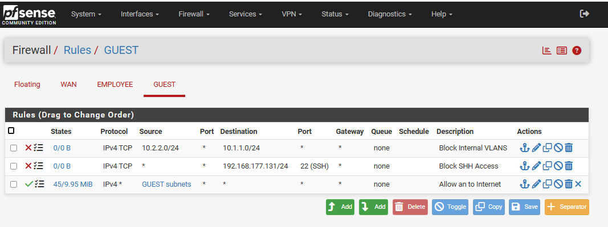

*Figure 5. Visible Guest isolation and SSH restriction rules.*

**Rule interpretation:** The internal subnet deny is shown as **IPv4 TCP**, not a blanket block of *every protocol*. This means ICMP/ping testing alone cannot establish whether that TCP-specific rule matched. A stronger validation combines a bounded TCP attempt, relevant pfSense rule counters, and firewall logs. The separate SSH destination field and Employee SSH rule should also be checked for subnet/host notation before reuse.

### 07 · Validate endpoint and gateway connectivity

On the Windows Employee VM, `ipconfig` shows **10.1.1.100/24** with gateway **10.1.1.1**. A ping from Windows to **192.168.177.131** succeeds, returning **four replies and zero packet loss**. This verifies one permitted Employee-to-WAN-side path at the time of capture.

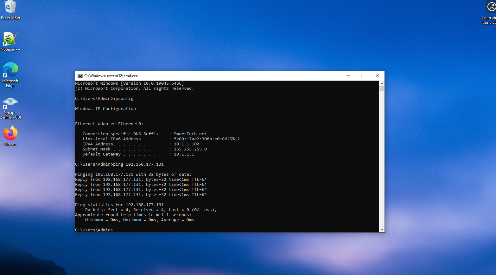

*Figure 6. Original Employee endpoint address and connectivity to pfSense WAN IP.*

### 08 · Probe access from the external Kali client

The Kali screenshots show **failed ICMP probes** to **10.1.1.100** and, in one earlier capture, to **192.168.177.131**. A later capture shows **11/11 successful replies** when Kali pings **192.168.177.131**. This shows the importance of specifying **which host, rule, interface and test time** each observation refers to.

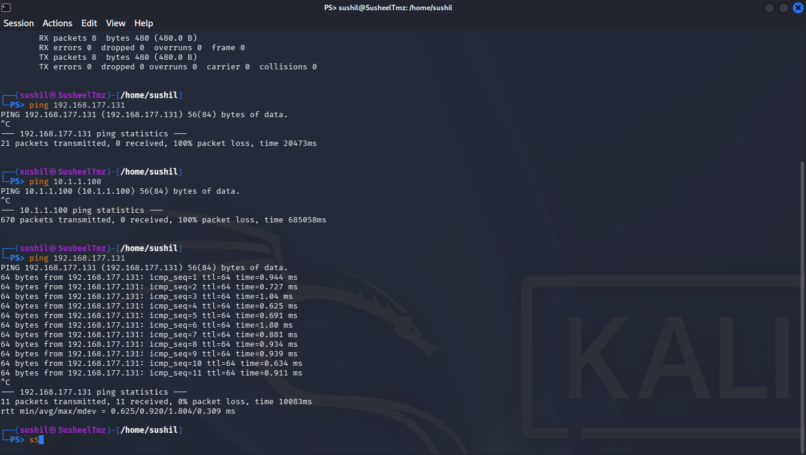

*Figure 7. Recorded unsuccessful probes and later successful reachability to the WAN-side interface.*

### 09 · Generate authorized security-test traffic

The supplied Kali captures include **high-rate TCP SYN traffic** directed toward **10.1.1.100:80** using `hping3` in flood mode, with no replies reported by the sending tool. These were controlled home-lab experiments rather than evidence of a successful denial-of-service condition.

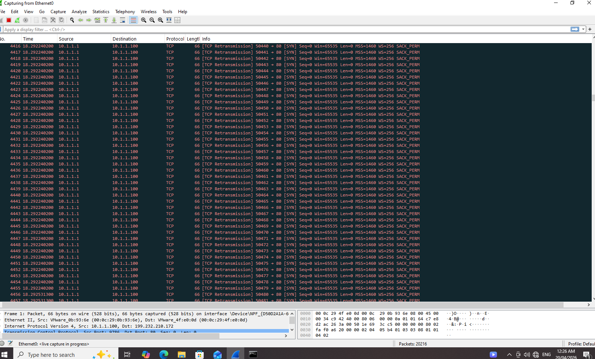

*Figure 8. Original captured test activity; high-rate flood testing should only be performed in an isolated environment with explicit authorization. The screenshot is documentation, not a recommended production command.*

### 10 · Examine TCP packets using Wireshark

I inspected traffic in Wireshark alongside the pfSense interface and event dashboard. The supplied capture displays repeated **TCP SYN retransmissions** involving **10.1.1.1** and the Windows host **10.1.1.100** toward TCP **80**.

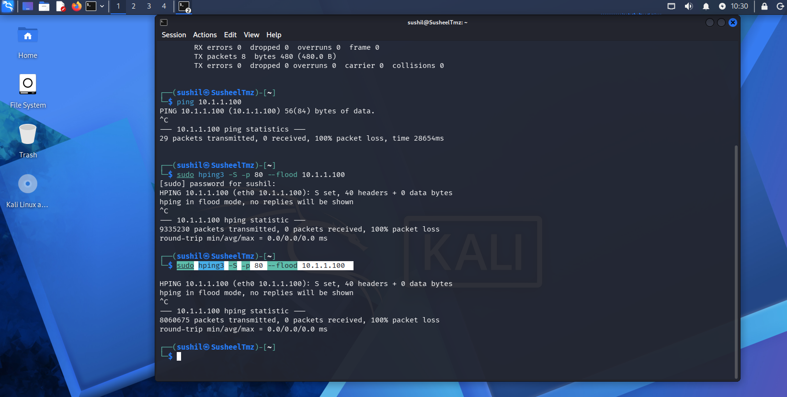

*Figure 9. Packet-level TCP SYN retransmission evidence. Retransmissions alone do not identify the precise cause of failure.*

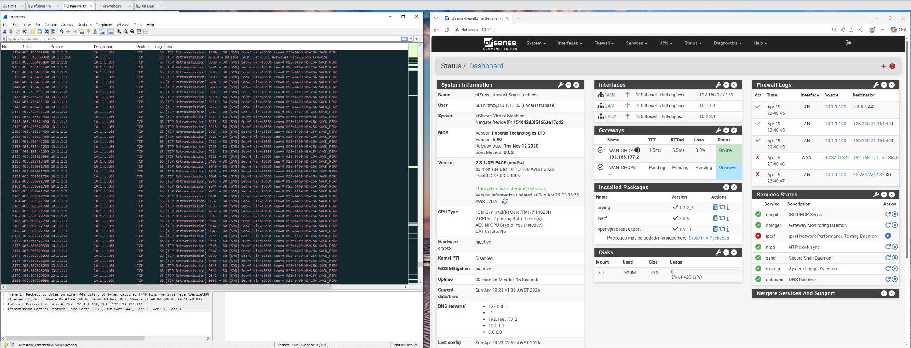

*Figure 10. Cross-checking observed network packets with pfSense dashboard information.*

### 11 · Verify security packages and version status

The pfSense dashboard shows **pfBlockerNG** installed, with IP/DNSBL status widgets visible. The update page shows the running and latest base system as **2.8.1**, with **“Up to date”** displayed in that recorded session.

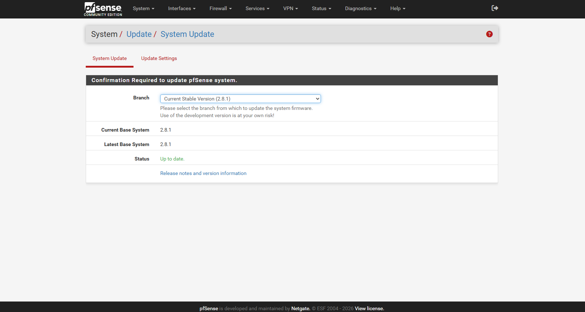

*Figure 11. Original system-version and update-check evidence.*

## 🔐 Extended lab — OpenVPN remote access and Snort IDS

The original pfSense console also shows additional server and management interfaces, plus five VLAN subinterfaces beyond the simplified initial diagram. The following are screenshots from the extended lab, not proof that every VLAN has been independently tested.

### OpenVPN remote-user connectivity

Configured **SSL/TLS + user-authentication** OpenVPN profiles are visible for Contractor (UDP 1194, tunnel `10.0.100.0/24`) and Remote Users (UDP 1195, tunnel `10.10.10.0/24`). The original client recording shows **Connected**, **Initialization Sequence Completed** and the assigned tunnel address `10.10.10.2`. Earlier connection errors are also present in the log, so this is evidence of a successful later connection rather than an uninterrupted session.

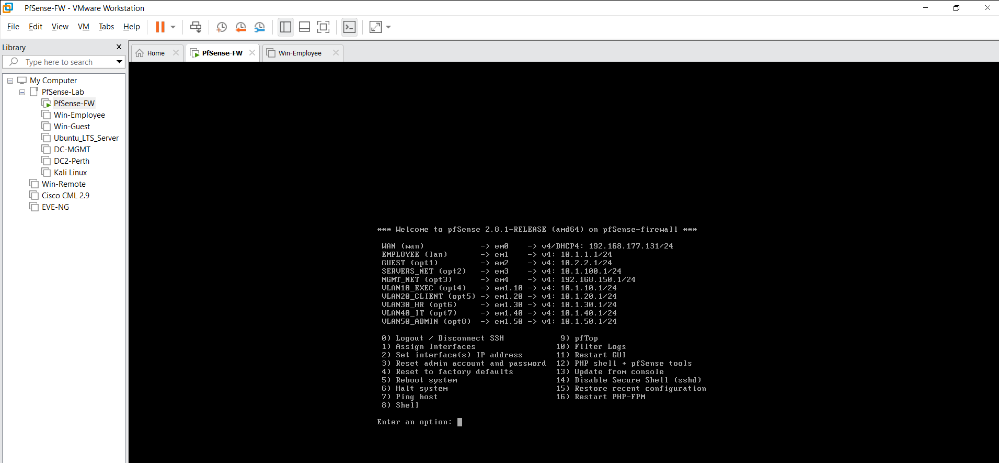

*Figure 12. Deployed interface details, including the server/management interfaces and employee VLANs.*

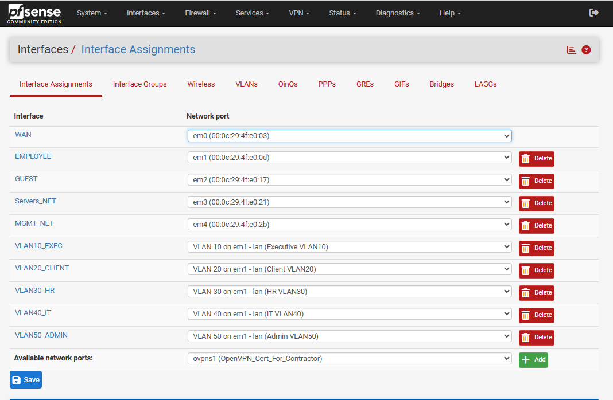

*Figure 13. Interface mappings and VLAN assignments.*

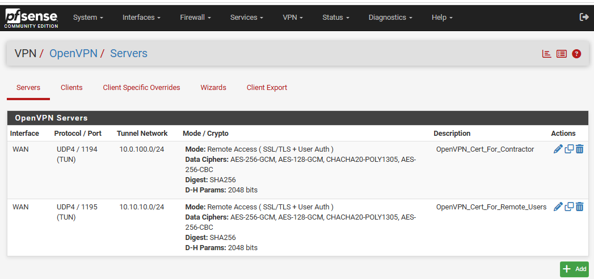

*Figure 14. Contractor and Remote Users OpenVPN profiles.*

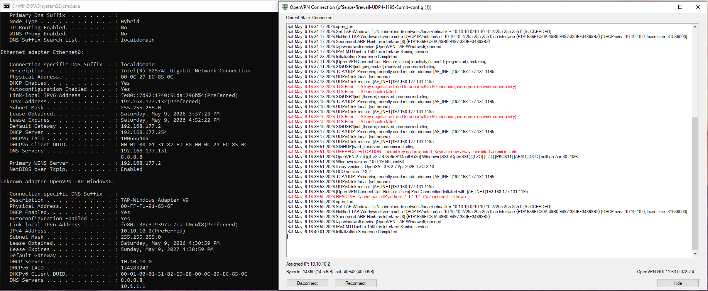

*Figure 15. Client-side tunnel status and assigned virtual IP.*

[OpenVPN configuration and validation notes](docs/OPENVPN.md)

### Snort IDS — network alert investigations

The Snort **EMPLOYEE (em1)** alert screenshots document three local detection objectives: SSH connection monitoring (SID `1000001`), HTTP domain-related monitoring (SID `1000002`), and an HTTP upload size-related alert (SID `1000003`). The local rules were evaluated in an authorized lab.

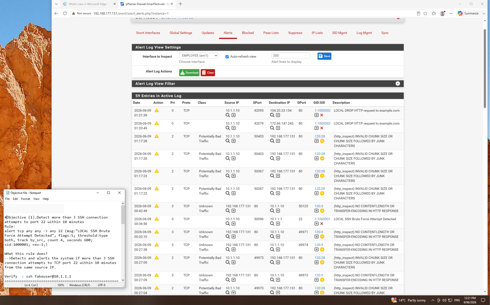

*Figure 16. SSH-monitoring alert evidence, with student number redacted.*

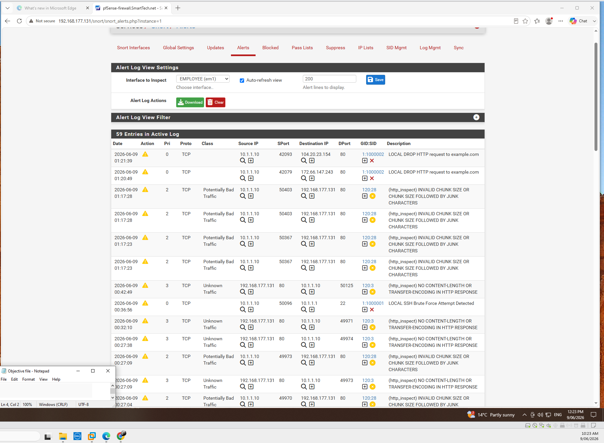

*Figure 17. Domain-related HTTP alerts and HTTP inspector anomalies, with student number redacted.*

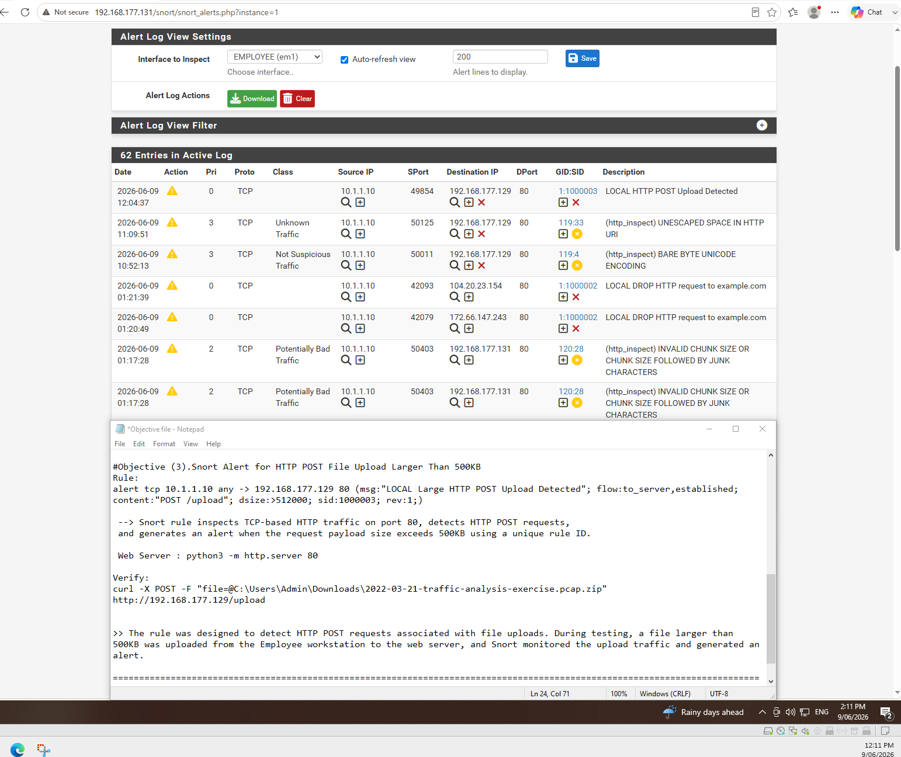

*Figure 18. Upload-monitoring alert and supporting notes.*

**Analyst finding:** These captures establish that Snort generated alert records. They do **not**, by themselves, prove a password compromise, data exfiltration, or that a rule blocked traffic. The alert message and actual enforcement decision must be checked separately.

[Snort IDS evidence and investigation guide](docs/SNORT_IDS.md)

## 🔎 Firewall rule summary

| Interface | Policy shown | Captured state | Security purpose |
|---|---|---|---|
| Guest | Block TCP from `10.2.2.0/24` to `10.1.1.0/24` | Deny rule visible | Reduce lateral access to Employee LAN |
| Guest | Block TCP/22 to NAT-side host/address range | Deny rule visible | Restrict SSH management exposure |
| Guest | Pass Guest subnets to any | Allow rule below denies | General egress after preceding denies |
| Employee | Allow defined SSH path | Pass rule visible | Authorized management/connectivity |
| Employee | Allow Employee subnets | Pass rule visible | Normal LAN access |
| Employee | Social Media Block | **Disabled** | Not enforced in screenshot |
| Employee | Block HTTP from any | **Disabled** | Not enforced in screenshot |
| Employee | Allow ICMP | Pass rule visible | Diagnostics |

For the exact displayed values and interpretation caveats, see [Firewall policy documentation](docs/FIREWALL_POLICIES.md).

## 🧪 Observed test results

| Check | Source → destination | Evidence | Interpretation |
|---|---|---|---|
| pfSense installation | Web setup wizard | Wizard completed | Setup was completed |
| Interface availability | pfSense dashboard | WAN/Employee/Guest up | Three operational interfaces shown |
| Windows connectivity | `10.1.1.100 → 192.168.177.131` | 4 sent, 4 received | Path reachable in captured test |
| Kali-to-Employee ping | Kali → `10.1.1.100` | No ICMP reply | Unreachable by ICMP in captured test; cause not proven |
| Kali-to-pfSense WAN | Kali → `192.168.177.131` | Earlier loss, later 11/11 replies | Results depend on test conditions/time |
| High-rate SYN activity | Kali → `10.1.1.100:80` | Flood test and 0 replies reported | Does not alone prove target exhaustion or a firewall block |
| Packet capture | `10.1.1.1 → 10.1.1.100:80` | Repeated SYN retransmissions | Connection establishment issues observed |
| DHCP service | pfSense dashboard | `dhcpd` running | DHCP service health visible; lease allocation not shown |
| pfBlockerNG | Package and dashboard widgets | Installed / status visible | Filtering effectiveness requires separate proof |

### What “build → test → defend” taught me

**Build:** Create separated virtual networks and consistent gateway routing.

**Test:** Check addresses, paths, services and controlled packet behavior from the correct source interface.

**Defend:** Apply specific deny policies **before** broad allow rules, scope administrator access, and inspect results.

**Validate:** Match packet captures and firewall decision logs to the rule being tested. Avoid assuming all packet loss is caused by a firewall or that failed SYN connections prove a successful DoS.

## 🎓 Relevance to SOC Analyst Level 1

This project strengthened my foundation in **network segmentation, alert/log interpretation, suspicious traffic identification, basic incident triage, firewall rule analysis, packet investigation and evidence-based reporting**. It demonstrates how a junior analyst can determine *what was attempted*, *what was observed*, *what policy applied*, and *what should be escalated for further analysis*.

## 📂 Project documentation

| Resource | Description |
|---|---|
| [Implementation guide](docs/IMPLEMENTATION.md) | Network creation, DHCP verification, management access and safe validation steps |
| [Firewall policies](docs/FIREWALL_POLICIES.md) | Captured Employee and Guest rule sets and rule-order analysis |
| [Traffic analysis](docs/TRAFFIC_ANALYSIS.md) | ICMP, SYN, Wireshark and test/defend interpretation |
| [Evidence index](docs/EVIDENCE.md) | All original screenshots with exact matching filenames |
| [OpenVPN remote access](docs/OPENVPN.md) | Server profiles, tunnel assignment and client status |
| [Snort IDS investigations](docs/SNORT_IDS.md) | Three local detection cases and alert interpretation |
| [Security notes](SECURITY.md) | Scope, lab safety and redaction principles |

> **Lab safety:** All traffic-generation activities are confined to systems owned or explicitly authorized for testing. High-rate packet generation must not be repeated against public or shared networks. Real management access should use HTTPS and least privilege.

---

**Defensive Networking · Network Traffic Analysis · SOC L1 Investigation**

[← My GitHub portfolio](https://github.com/Ryalghost-SusheelTmz)

