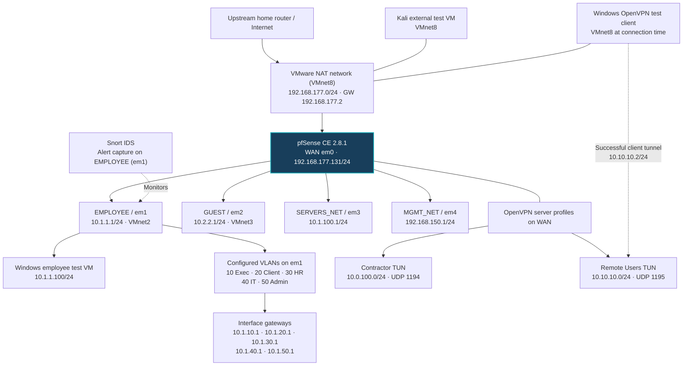
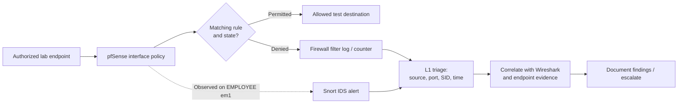
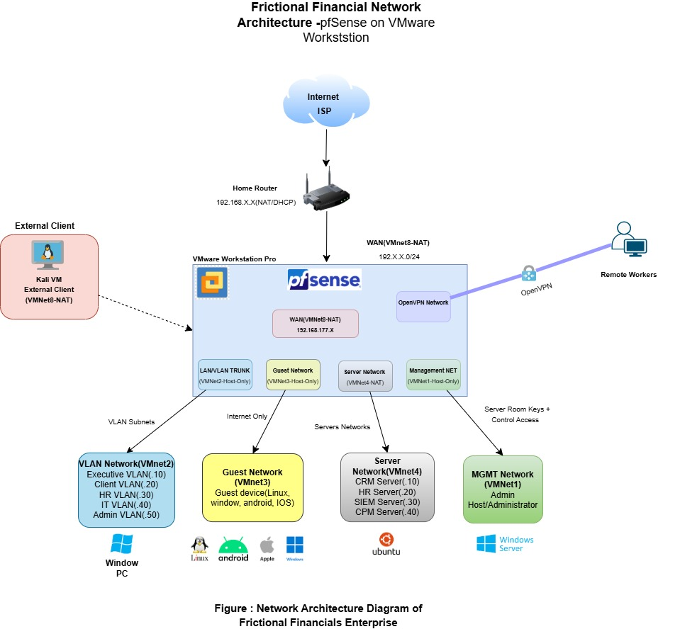

# Network Architecture — pfSense Firewall, VLANs, OpenVPN and Snort

## Purpose and source of truth

This document maps the **deployed interface assignments and security features visible in the original lab screenshots** to a logical network diagram. The historical design image in the README is preserved, but does not show all later-added interfaces, VLANs, VPN profiles and IDS monitoring.

- **Original deployment evidence:** [pfSense console](../assets/evidence/12-pfsense-vm-console.png), [interface assignments](../assets/evidence/13-interface-assignments-and-vlans.png), [pfSense dashboard](../assets/evidence/03-pfsense-dashboard.png).
- **Security feature evidence:** [Guest rules](../assets/evidence/05-guest-firewall-rules.png), [OpenVPN profiles](../assets/evidence/14-openvpn-server-profiles.png), [VPN connected](../assets/evidence/15-openvpn-client-connected.png), [Snort alert view](../assets/evidence/16-snort-ssh-detection.png).

## 1. Logical network architecture (deployment evidence)

**Diagram semantics:** Solid connectors show logical network attachments or **configured interfaces** as recorded; they do not prove that all possible paths are permitted by firewall policy. The VPN-client dotted connector represents **one observed completed tunnel**; it is not a claim that the remote client had reachability to all internal networks. Snort is shown monitoring the Employee interface, not as a separate physical inline firewall or a sensor confirmed on every VLAN.

## 2. Interface and subnet inventory

| Role | pfSense interface | Recorded address | Network connection / evidence |
|---|---|---|---|
| WAN | em0 | 192.168.177.131/24 | VMware NAT VMnet8, console/dashboard |
| Employee | em1 | 10.1.1.1/24 | VMnet2 host-only in original design |
| Guest | em2 | 10.2.2.1/24 | VMnet3 host-only in original design |
| Servers | em3 | 10.1.100.1/24 | Configured; VMware VMnet mapping not shown |
| Management | em4 | 192.168.150.1/24 | Configured; VMware VMnet mapping not shown |
| Executive | em1.10 | 10.1.10.1/24 | VLAN 10 configured on em1 |
| Client | em1.20 | 10.1.20.1/24 | VLAN 20 configured on em1 |
| HR | em1.30 | 10.1.30.1/24 | VLAN 30 configured on em1 |
| IT | em1.40 | 10.1.40.1/24 | VLAN 40 configured on em1 |
| Admin | em1.50 | 10.1.50.1/24 | VLAN 50 configured on em1 |

For VLANs, an assigned parent/subinterface **does not verify** a VLAN-aware virtual switch, tagged endpoint, DHCP scope or inter-VLAN enforcement. Those require dedicated packet and policy evidence.

## 3. Access control and security components

| Component | Logical placement | Verified observation | Not yet demonstrated |
|---|---|---|---|
| pfSense rules | At ingress interfaces | Guest TCP restriction to Employee subnet is visible before broad Guest allow; Employee rules visible | All-protocol Guest isolation; validated blocking for every VLAN |
| DHCP | pfSense service | dhcpd running in status view; Windows and VPN address evidence | Per-interface DHCP scope and lease-table evidence |
| Management | pfSense GUI / SSH | Employee GUI access and management interface configured | GUI/SSH restricted exclusively to MGMT_NET |
| OpenVPN | pfSense WAN services | Two remote-access profiles and successful Remote Users tunnel | Remote-user reachability to all LANs, remote public-Internet connectivity |
| Snort IDS | EMPLOYEE (em1) | Original local SSH, HTTP policy and upload-alert records | IPS packet drops or Snort coverage of Guest, Servers and all VLANs |
| pfBlockerNG | pfSense package | Package/status widgets visible | A specific IP/DNSBL block verified by packet test |

## 4. Security traffic-flow view

This is an **analyst workflow diagram**, not a claim that every Snort alert resulted in a block. Snort local alert messages containing “DROP” are not equivalent to verified IPS enforcement.

## 5. Original diagram: historical, simplified view

*The original diagram documents the early three-segment design. Its home-router-side 192.168.1.0/24 label should not be interpreted as pfSense's WAN interface; the deployed WAN in the console is 192.168.177.131/24 on VMnet8.*

## 6. Validation gaps and safe practice

- Document actual VMware virtual-network assignments for **Servers** and **Management** separately, since the available evidence only establishes the pfSense NIC mapping.
- Test isolation using the protocol the actual rule filters; the Guest-to-Employee deny screenshot is **TCP-specific** and does not prove every protocol is denied.
- Confirm management access restrictions in live pfSense settings; having a management subnet **does not** automatically make the GUI unreachable elsewhere.
- Confirm Snort sensor assignments separately before claiming all-VLAN detection, and verify any prevention decision in block/filter logs.
- Do not treat an OpenVPN session from a Windows VM on VMnet8 as proof of an Internet-facing remote-access path.
- Keep testing authorized and low impact; do not expose client certificates, credentials, private keys, configuration exports or live public routing details.

**SOC L1 takeaway:** Network security evidence is strongest when topology, ingress interface, exact firewall rule, IDS signature, endpoint log and packet capture all agree.
