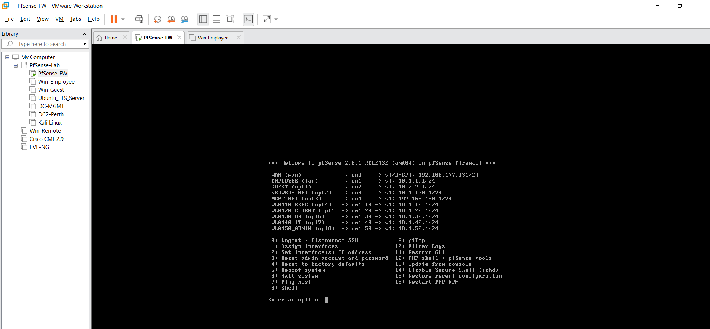
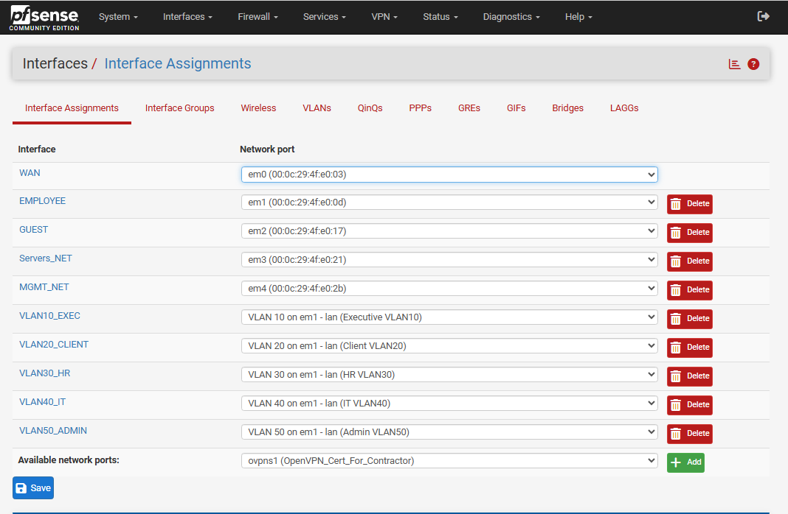
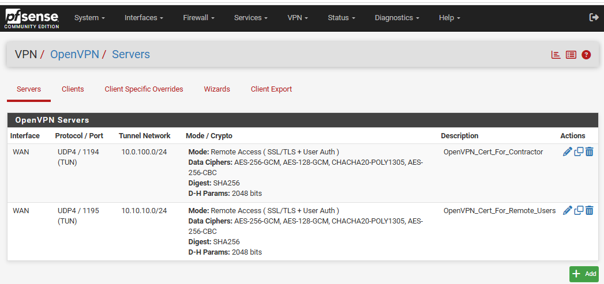
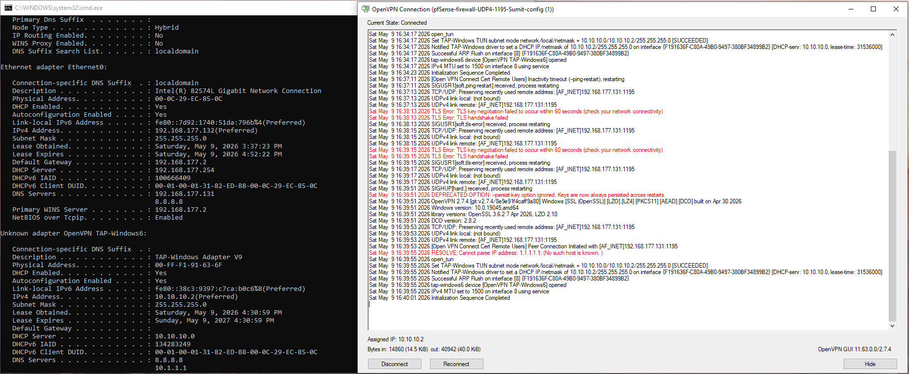

# OpenVPN remote access — observed deployment

The supplied pfSense console shows WAN, EMPLOYEE, GUEST, SERVERS_NET, MGMT_NET and five employee VLAN subinterfaces. The **Interfaces → Assignments** screenshot documents their interface mappings.

## VPN configuration

The **VPN → OpenVPN → Servers** screen records two remote-access TUN profiles configured for SSL/TLS plus user authentication. A Contractor profile uses UDP 1194 with tunnel network 10.0.100.0/24. A Remote Users profile uses UDP 1195 with tunnel network 10.10.10.0/24.

## Client verification

The Windows OpenVPN GUI screenshot shows **Connected**, **Initialization Sequence Completed**, and assigned tunnel IP 10.10.10.2/24. The log also contains earlier connection and DNS errors before successful initialization. The capture proves successful tunnel establishment at that time, not access to every internal VLAN.

## Security considerations

Permit only authorized VPN accounts and allowed internal resources. Verify remote-access policy in pfSense rather than assuming the VPN allows every subnet. Avoid publishing exported VPN client profiles, private keys or credentials. Verify that upstream router and firewall rules do not expose unnecessary services.
