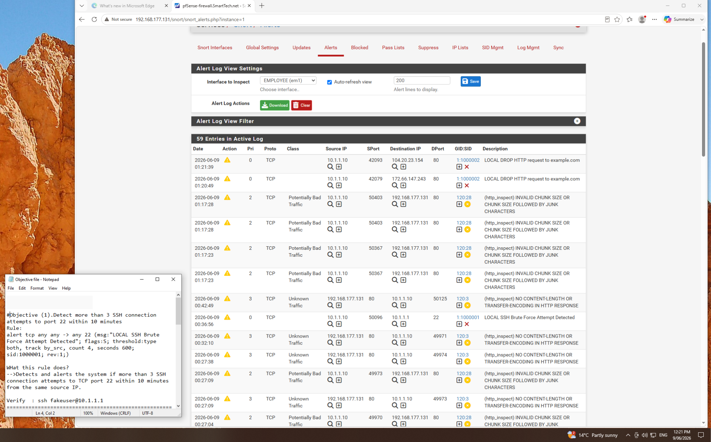
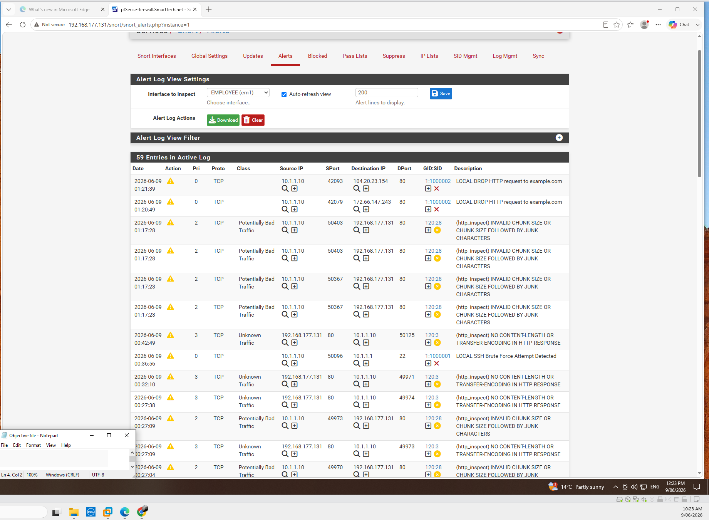
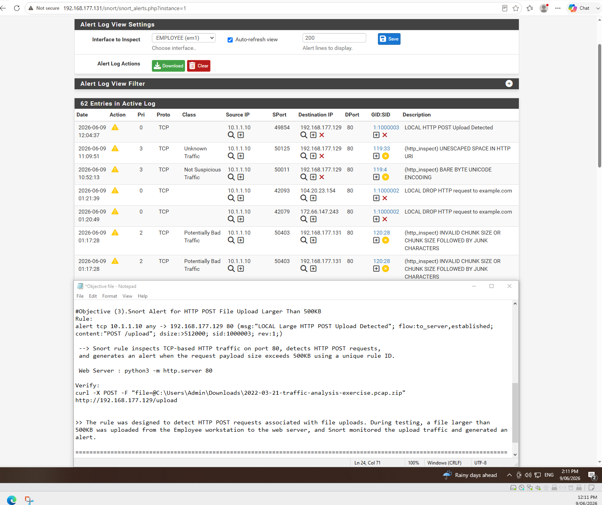

# Snort IDS — security alert investigation

This section documents the original Snort alert screenshots from the Employee interface of the pfSense lab.

## Observed detection cases

| Case | Evidence | Analyst interpretation |
|---|---|---|
| SSH monitoring | Local signature 1000001, TCP port 22 | A threshold-based connection alert; confirm account activity separately |
| HTTP policy monitoring | Local signature 1000002, HTTP traffic | Recorded policy alert; a message label does not prove traffic blocking |
| HTTP upload monitoring | Local signature 1000003 | A local upload alert from the authorized lab, not proof of data exfiltration |

## Screenshot evidence

The alert screens also show HTTP inspector events for malformed chunk formatting and encoding. Alert counters and severity should be interpreted in context.

## SOC L1 process

Review timestamp, source, destination, interface and signature. Correlate associated network events and verify whether traffic was only logged or actually blocked. Document findings and escalate unexpected behavior. These screenshots show detection visibility, not proof of a successful attack or prevention.
